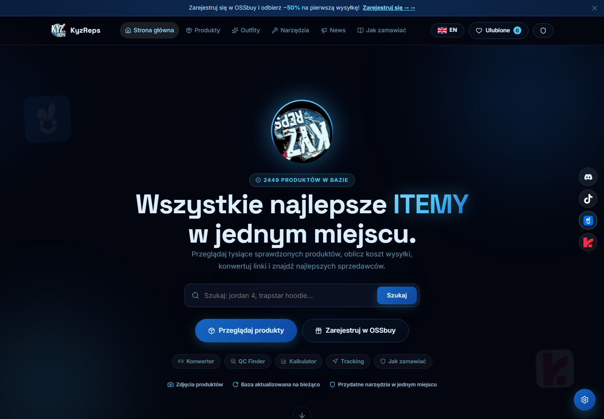
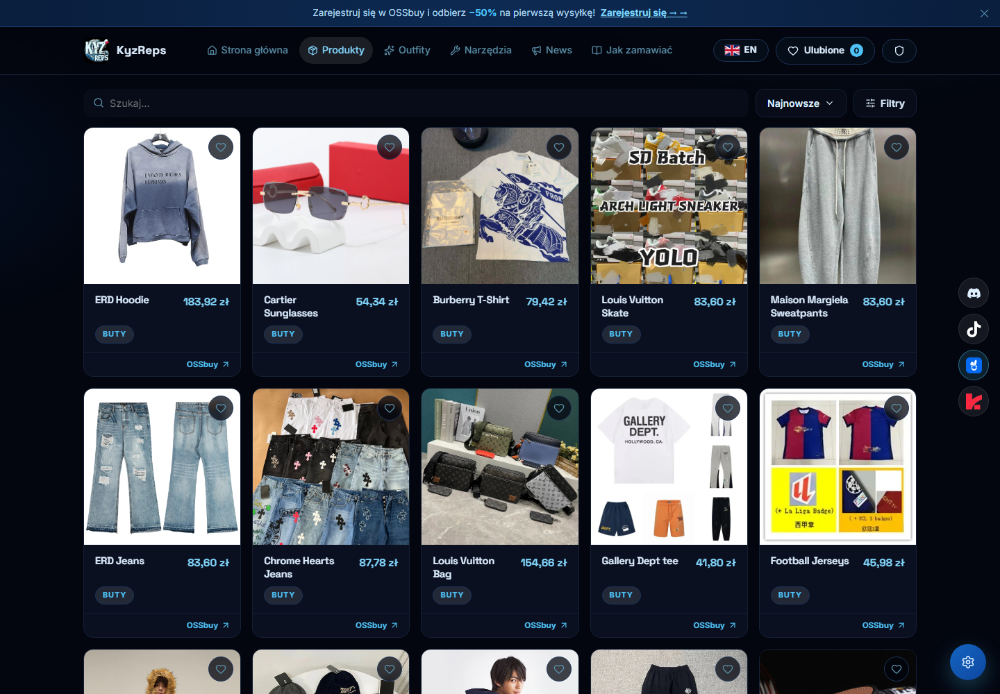
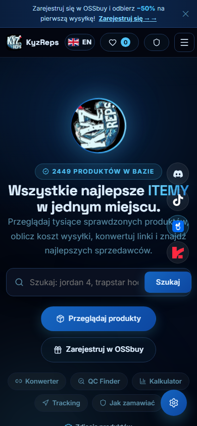

# KyzReps

Platforma do przeglądania produktów z Google Sheets, z filtrowaniem, ulubionymi, outfitami, narzędziami zakupowymi oraz panelem administratora. Frontend: **React 19, React Router, Vite**. Backend: **Node.js, Express**, integracje API i lokalny zapis JSON.

> **Repozytorium zawiera kod bez sekretów i danych produkcyjnych. Strona nie będzie działać w pełni bez własnych spreadsheetów Google, dostępu do ich danych, kluczy API i wymaganych sekretów.** Samo uruchomienie interfejsu nie zapewnia działającego katalogu ani zewnętrznych integracji. GitHub Pages nie uruchamia backendu Express.

## Screenshoty

Rzeczywiste zrzuty lokalnie uruchomionej strony z istniejącą konfiguracją oraz katalogiem produktów, wykonane przed publikacją oczyszczonej kopii. Przeglądarka miała ustawione preferencje użytkownika i pomijała ekran powitalny oraz ekran CAPTCHA. Zrzuty przedstawiają wygląd aplikacji; nie oznaczają przetestowania wszystkich integracji, logowania lub CAPTCHA. Dane i konfiguracja ze zrzutów nie są dołączone do repozytorium.







## Uruchomienie lokalne

Wymagany Node.js **22.12 lub nowszy** i npm.

```sh
npm ci
```

Skopiuj pliki konfiguracyjne (PowerShell):

```powershell
Copy-Item .env.example .env
Copy-Item server/data/sheets.example.json server/data/sheets.json
```

Na Linux/macOS użyj odpowiednio `cp`. Uzupełnij `.env` i `server/data/sheets.json` własnymi wartościami, następnie:

```sh
npm run dev
```

Frontend: `http://localhost:5173`. Backend: `http://localhost:3002`. Vite przekazuje żądania `/api` do backendu. Jeśli port frontendu zostanie zmieniony, dodaj nowy origin do `CORS_ORIGINS`.

## Wymagana konfiguracja

| Ustawienie | Zastosowanie |
| --- | --- |
| `GOOGLE_API_KEY` | Pobieranie katalogu przez Google Sheets API; w projekcie Google Cloud musi być włączone Sheets API i klucz musi mieć dostęp do właściwych arkuszy. |
| `GOOGLE_API_KEY_2` | Opcjonalny dodatkowy klucz obsługiwany przez mechanizm pobierania danych. |
| `server/data/sheets.json` | Własne adresy arkuszy, nazwy zakładek, zakresy i mapowanie kolumn. W repozytorium jest tylko przykład z placeholderami. |
| `SHEET1_ID`, `SHEET2_ID` | Własne identyfikatory arkuszy dla ścieżki CSV. Fallback wymaga publicznie dostępnych arkuszy i poprawnych identyfikatorów zakładek `gid` w adresach CSV w `server/index.js`. |
| `DEFAULT_ADMIN_PASSWORD` | Własne hasło o długości co najmniej 12 znaków; tworzy konto `admin` przy pierwszym uruchomieniu. Bez poprawnego hasła nowe konto administratora nie powstanie. |
| `VITE_TURNSTILE_ENABLED` | `true` włącza ekran CAPTCHA; domyślnie `false` w przykładzie dla lokalnego uruchomienia. |
| `VITE_TURNSTILE_SITE_KEY`, `TURNSTILE_SECRET` | Własny publiczny site key oraz prywatny sekret Cloudflare Turnstile. Skonfiguruj dozwolone hosty i oba klucze przed włączeniem CAPTCHA. |
| `CORS_ORIGINS`, `PORT`, `NODE_ENV` | Dozwolone adresy frontendu, port backendu i tryb środowiska. |
| `DISCORD_CLIENT_ID`, `DISCORD_CLIENT_SECRET`, `DISCORD_REDIRECT_URI` | Własna aplikacja Discord OAuth do logowania. Redirect URI musi odpowiadać adresowi skonfigurowanemu w Discord Developer Portal. |
| `DISCORD_GUILD_ID`, `DISCORD_BOT_TOKEN` | Własny serwer Discord i bot do funkcji związanych z członkostwem na serwerze. |

Indeksy kolumn w przykładzie `sheets.example.json` zaczynają się od zera. `name` wskazuje nazwę produktu, `img` obraz lub formułę IMAGE, `usd` cenę w USD, a `raw` oryginalny link produktu. Dopasuj mapowanie do struktury własnych arkuszy. Nazwy zakładek w przykładzie pokazują strukturę oryginalnej integracji, ale możesz je zmienić. Po zmianie konfiguracji zrestartuj backend.

Nie umieszczaj prywatnych kluczy w zmiennych zaczynających się od `VITE_`: te wartości trafiają do kodu przeglądarki. Wszystkie pliki `.env*` poza `.env.example` oraz rzeczywiste dane serwera są ignorowane przez Git.

## Build i wdrożenie

```sh
npm run build
```

Backend obsługuje API i zbudowany frontend z `dist/`. Przygotuj na serwerze prywatny plik `.env.production` z konfiguracją backendu i `NODE_ENV=production`, a następnie uruchom:

```sh
npm start
```

Zmienne `VITE_*` muszą być ustawione podczas budowania frontendu, np. w lokalnym lub CI `.env.production`. Serwer produkcyjny wymaga HTTPS i reverse proxy ustawiającego `X-Forwarded-Proto: https`. Ustaw `CORS_ORIGINS` na własne domeny i zapewnij trwały, zapisywalny katalog `server/data/`.

## Zakres publikacji

Nie dołączono kluczy API, sekretów OAuth, tokenów botów, haseł i hashy kont, oryginalnych identyfikatorów spreadsheetów, konfiguracji produkcyjnej, ulubionych użytkowników, cache katalogu ani archiwów. Dane serwera powstają lokalnie podczas uruchamiania aplikacji. Część interfejsu i narzędzi może działać bez integracji, ale pełne działanie wymaga opisanej konfiguracji i dostępności usług zewnętrznych.
